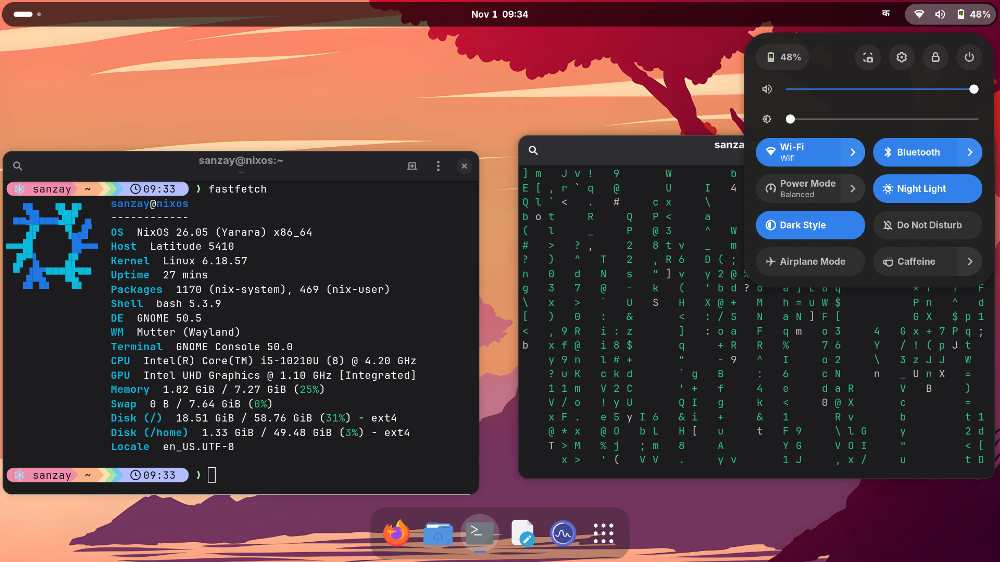
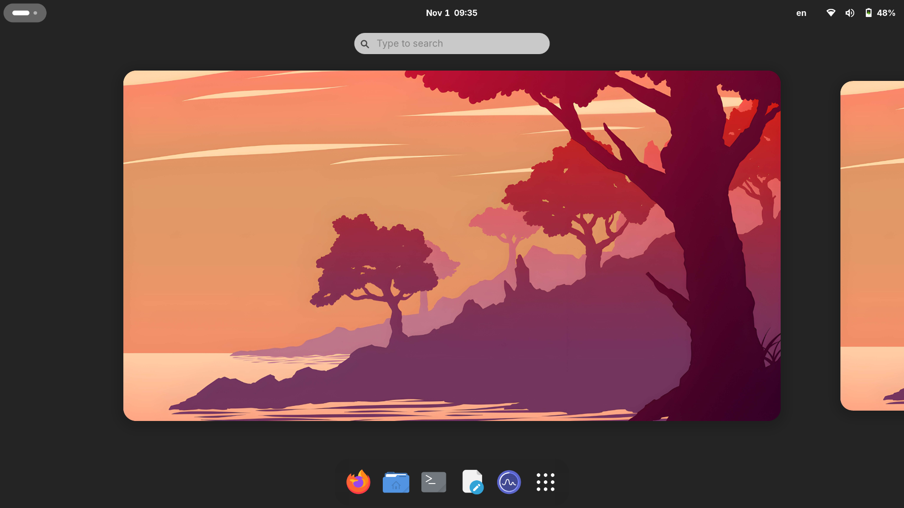
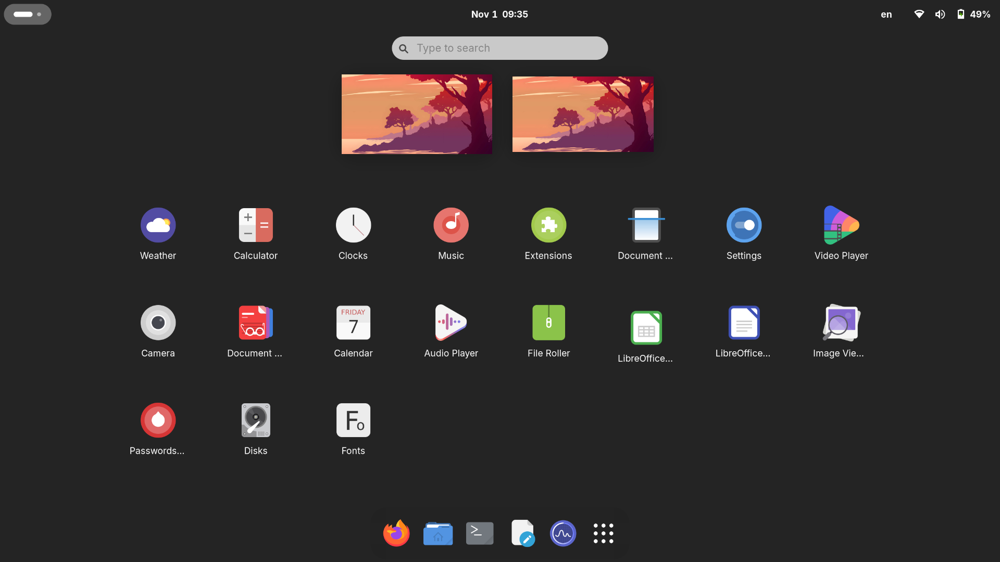
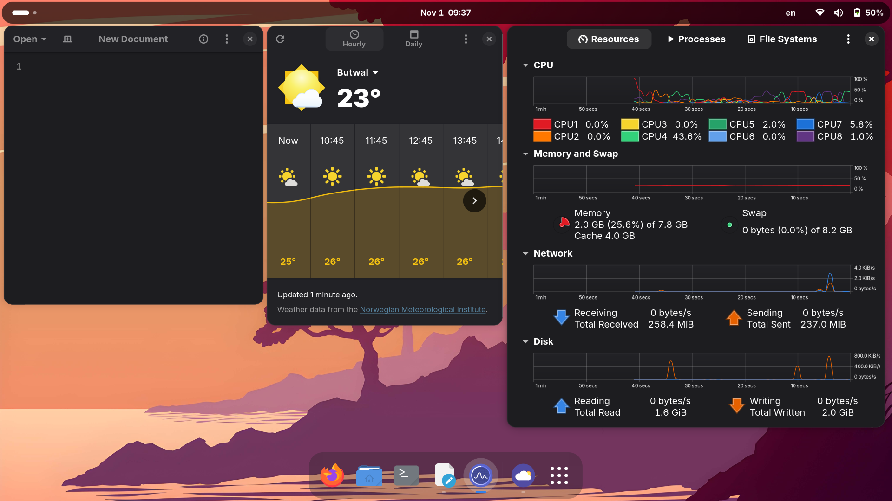

# NixOS · GNOME configuration

A declarative NixOS configuration for a Dell Latitude 5410, using GNOME and
Home Manager. The flake is the entry point; one `nixos-rebuild` builds both the
system and the user environment.

> **Repository location:** `/etc/nixos`  
> **Flake target:** `nixos`  
> **Release branch:** NixOS / nixpkgs `26.05`, Home Manager `release-26.05`

## Desktop

<p align="center">
  
  
  
  
</p>

## Repository layout

`Assets/` is intentionally at the repository root beside `home/` and
`modules/`. It contains files used by the configuration but is not itself a
NixOS module tree.

```text
/etc/nixos/
├── Assets/                         # Shared static assets
│   ├── fonts/                      # Local Nepali font files
│   │   ├── Kalimati.otf
│   │   ├── Kantipur.otf
│   │   └── Preeti.otf
│   ├── screenshots/                # Images embedded in this README
│   │   ├── 01-desktop-terminal-quick-settings.png
│   │   ├── 02-overview.png
│   │   ├── 03-app-grid.png
│   │   └── 04-apps-weather-system-monitor.png
│   └── wallpapers/                 # Images linked to ~/Pictures/Wallpapers
│       ├── alejagalesa-another-world.jpg
│       └── alejagalesa-camp.jpg
├── flake.nix                       # Inputs and nixosConfigurations.nixos
├── flake.lock                      # Pinned input revisions
├── README.md
├── hosts/
│   └── latitude-5410/
│       ├── default.nix             # Hostname, stateVersion, imports
│       └── hardware-configuration.nix
├── modules/                        # System-wide NixOS configuration
│   ├── default.nix                 # Imports the system modules
│   ├── apps/
│   │   └── firefox.nix             # Firefox policies and preferences
│   ├── core/
│   │   ├── boot.nix                # systemd-boot and quiet Plymouth boot
│   │   ├── home-manager.nix        # Integrates Home Manager
│   │   ├── locale.nix              # Kathmandu timezone, locale, RTC
│   │   ├── networking.nix          # NetworkManager
│   │   ├── nix.nix                 # Flakes, build limits, GC, optimisation
│   │   ├── packages.nix            # System packages
│   │   ├── services.nix            # CUPS, nix-ld, journal limit
│   │   └── users.nix               # Login account and groups
│   ├── desktop/
│   │   ├── fonts.nix               # System fonts; reads ../../Assets/fonts
│   │   ├── gnome.nix               # GDM, GNOME, excluded apps, GDM cursor
│   │   └── ibus.nix                # IBus m17n Nepali input method
│   └── hardware/
│       ├── audio.nix               # PipeWire
│       ├── graphics.nix            # Intel graphics and VA-API
│       ├── intel.nix               # Intel microcode, firmware, thermald
│       ├── laptop.nix              # Power profiles, Bluetooth, fwupd, TRIM
│       └── memory.nix              # zram, swapfile, earlyoom
└── home/                            # Per-user Home Manager configuration
    ├── default.nix                 # Imports user modules; home.stateVersion
    ├── apps/
    │   ├── mimeapps.nix             # Default applications by MIME type
    │   └── packages.nix             # User applications
    ├── desktop/
    │   └── gnome/
    │       ├── app-settings.nix     # Appearance, dock, apps, weather, bookmarks
    │       ├── extensions.nix      # GNOME Shell extensions
    │       ├── input.nix           # Touchpad, NumLock, keyboard layouts
    │       ├── keybinds.nix        # Custom and remapped shortcuts
    │       ├── power.nix           # Idle, lock, suspend, Night Light
    │       └── services.nix        # Wallpaper timer and theme watcher
    └── shell/
        ├── bash.nix                # Aliases, history, fastfetch on first shell
        ├── fastfetch.nix           # Fastfetch layout
        ├── git.nix                 # Git identity and defaults
        ├── starship.nix            # Starship activation
        ├── starship.toml           # Prompt appearance
        └── tools.nix               # CLI tools and direnv
```

### Where assets are connected

- `Assets/wallpapers/` is linked by `home/desktop/gnome/app-settings.nix`
  into `~/Pictures/Wallpapers`; the user service in `services.nix` selects a
  random image every four minutes.
- `Assets/fonts/` is packaged by `modules/desktop/fonts.nix`.
- `Assets/screenshots/` contains documentation images only.

**Important:** flakes include files known to Git. After adding, removing or
renaming an asset or Nix file, stage the change before rebuilding:

```bash
cd /etc/nixos
git add -A
```

## What is configured

### System and hardware

| Area | Configuration | File |
|---|---|---|
| Boot | UEFI systemd-boot, four generations, editor disabled, zero-second timeout; Plymouth and quiet kernel output | `modules/core/boot.nix` |
| Nix | Flakes, unfree packages, four build cores, two parallel jobs, idle daemon scheduling | `modules/core/nix.nix` |
| Maintenance | Weekly garbage collection of generations older than seven days; weekly store optimisation | `modules/core/nix.nix` |
| Locale | `Asia/Kathmandu`, `en_US.UTF-8`, hardware clock in local time | `modules/core/locale.nix` |
| Network | NetworkManager; NixOS firewall defaults remain enabled | `modules/core/networking.nix` |
| Services | CUPS printing, nix-ld for dynamically linked binaries, journal capped at 200 MB | `modules/core/services.nix` |
| CPU / firmware | Intel microcode, redistributable firmware, thermald | `modules/hardware/intel.nix` |
| Graphics | Intel media driver (iHD), VA-API, early i915 module, PSR disabled | `modules/hardware/graphics.nix` |
| Memory | zstd zram at 50%, 4 GiB swapfile, swappiness 100, earlyoom | `modules/hardware/memory.nix` |
| Audio | PipeWire with ALSA and PulseAudio compatibility, rtkit | `modules/hardware/audio.nix` |
| Laptop | UPower, power-profiles-daemon, Bluetooth, fwupd, weekly SSD TRIM | `modules/hardware/laptop.nix` |

### GNOME desktop

| Area | Configuration | File |
|---|---|---|
| Theme | Orchis Light/Dark, Tela/Tela-dark; user service follows GNOME colour scheme | `home/desktop/gnome/app-settings.nix`, `services.nix` |
| Cursor | Bibata-Modern-Ice, size 24; also configured for GDM | `app-settings.nix`, `modules/desktop/gnome.nix` |
| Fonts | Inter UI, JetBrainsMono Nerd Font terminal; Noto, emoji, CJK, Office-compatible and local Nepali fonts | `modules/desktop/fonts.nix`, `app-settings.nix` |
| Dock | Dash to Dock, fixed 30% opacity, Trash hidden; Firefox, Files, Console, Text Editor, System Monitor pinned | `app-settings.nix` |
| Wallpaper | Random wallpaper every four minutes, zoom mode, same image for light/dark | `services.nix`, `app-settings.nix`, `Assets/wallpapers/` |
| Behaviour | Hot corners off, battery percentage on, volume amplification above 100% off | `app-settings.nix` |
| Housekeeping | Automatically remove Trash and temporary files older than 30 days | `app-settings.nix` |
| Weather | Fixed GNOME Weather location: Butwal, Nepal | `app-settings.nix` |
| Input | Tap-to-click, natural scrolling, disable touchpad while typing, external-mouse disable; NumLock enabled; US + Nepali m17n | `input.nix`, `modules/desktop/ibus.nix` |
| Power | Screen blank after 5 minutes, immediate lock, suspend after 12 minutes on AC/battery, Night Light automatic; idle dim and ambient sensor off | `power.nix` |

### GNOME Shell extensions

Installed and enabled declaratively in `home/desktop/gnome/extensions.nix`:

- **Caffeine** — prevent automatic sleep when needed.
- **Dash to Dock** — configurable application dock.
- **App Hider** — hide selected launchers from the app grid.
- **AppIndicator** — tray icons for compatible applications.
- **User Themes** — allows the Orchis GNOME Shell theme.

### Firefox

Managed system-wide in `modules/apps/firefox.nix`:

- DuckDuckGo is the default search engine.
- Bitwarden and uBlock Origin are force-installed.
- Telemetry, studies, remote improvements, form history and built-in AI features are disabled.
- New-tab search remains enabled; Top Sites and sponsored content are disabled.
- Bookmarks are retained as address-bar suggestions; history, open-tab, shortcut,
  recent-search and search-engine suggestions are disabled.
- Search terms are not shown in the address bar after navigating to results.
- Bookmarks bar and touchpad swipe navigation are disabled.
- Intel VA-API preference is enabled.

Check the effective policy at `about:policies`.

### Apps and shell

- GNOME core apps are used for Files, PDF, images, text, video and audio.
- LibreOffice is installed; Writer, Calc and Impress are defaults for common
  Office document types. Unneeded LibreOffice launchers and GNOME Characters
  are hidden from the app grid.
- Bash includes `rebuild`, `rebuild-boot`, `rebuild-test`, `rebuild-check`,
  `clean`, `clean-all`, `ll`, `la`, `..` and `...`.
- Starship provides the prompt; Fastfetch appears once per boot.
- Git defaults and CLI tools are configured in `home/shell/`.

### Keyboard shortcuts

| Shortcut | Action |
|---|---|
| `Super` + `T` | Open GNOME Console |
| `Super` + `B` | Open Firefox |
| `Shift` + `Super` + `T` | Toggle dark/light mode |
| `Super` + `Q` or `Alt` + `F4` | Close window |
| `Super` + `F` | Maximise / restore |
| `Shift` + `Super` + `F` | Fullscreen |
| `Shift` + `Super` + `S` or `Print` | Screenshot UI |
| `Super` + `Space` | Switch English / Nepali input |

Edit `home/desktop/gnome/keybinds.nix` to change or add shortcuts.

## Common maintenance

Run these from `/etc/nixos`:

| Command | Effect |
|---|---|
| `rebuild` | Build and activate system + Home Manager now |
| `rebuild-boot` | Build and activate on next boot |
| `rebuild-test` | Activate temporarily, not as the boot default |
| `rebuild-check` | Build only; activate nothing |
| `clean` | Delete system generations older than seven days, refresh boot entry, collect garbage |
| `clean-all` | Delete old system generations and Nix eval cache, then collect garbage; removes rollback options |
| `nix flake update` | Update locked inputs; review and commit `flake.lock` |
| `sudo nixos-rebuild switch --rollback` | Switch to the previous system generation |
| `systemctl --user list-timers` | Inspect the wallpaper timer |
| `journalctl -b -p err` | Show errors from the current boot |

Suggested update routine:

```bash
cd /etc/nixos
nix flake update
git add flake.lock
rebuild-check
rebuild
git add -A
git commit -m "Update NixOS configuration"
```

## Install / adapt for another machine

This repository currently targets the Dell Latitude 5410. Do not copy its
hardware configuration blindly to another computer.

1. Clone the repository to `/etc/nixos`.
2. Generate that machine's hardware configuration with
   `sudo nixos-generate-config --show-hardware-config`.
3. Put the generated file in a new `hosts/<machine>/hardware-configuration.nix`
   and create a matching `default.nix` importing `../../modules`.
4. Add the new host to `flake.nix` and ensure its flake attribute matches
   `networking.hostName`.
5. Review Intel-specific modules, disk UUIDs, username, display name, timezone,
   Git identity and weather location.
6. `git add -A`, then run `rebuild-check` before switching.

Personal values currently live in:

| Setting | Location |
|---|---|
| Login name | `user` in `flake.nix` |
| Display name | `description` in `modules/core/users.nix` |
| Hostname / host folder | `hosts/latitude-5410/default.nix`, `flake.nix` |
| Hardware and disk UUIDs | `hosts/latitude-5410/hardware-configuration.nix` |
| Git name and email | `home/shell/git.nix` |
| Timezone and locale | `modules/core/locale.nix` |
| Weather city | `butwal` value in `home/desktop/gnome/app-settings.nix` |
| Build limits / swap size | `modules/core/nix.nix`, `modules/hardware/memory.nix` |
| Wallpapers / fonts | `Assets/wallpapers/`, `Assets/fonts/` |

## Change log

Use this section as a running log so the README stays useful as the
configuration evolves. Add a dated entry whenever a meaningful configuration
change is made. Keep the newest entry at the top.

### 2026-11-01 — Repository structure and documentation

- Added root-level `Assets/` alongside `home/` and `modules/`.
- Moved wallpapers from `home/desktop/wallpapers/` to `Assets/wallpapers/`.
- Moved local Nepali fonts from `modules/desktop/fonts/` to `Assets/fonts/`.
- Moved README screenshots from `screenshots/` to `Assets/screenshots/`.
- Updated the Nix source paths so Home Manager still links wallpapers and the
  system font module still packages the local font files.
- Rewrote this README against the configuration files and current asset list.

### Earlier configuration notes

The repository already contains the following configuration areas. Dates for
their original introduction are not recorded here; add dates only when known.

- NixOS flake with nixpkgs `nixos-26.05` and Home Manager `release-26.05`.
- Host-specific Latitude 5410 hardware configuration and shared system modules.
- GNOME desktop, Orchis/Tela theme switching, cursor, dock and GNOME extensions.
- Nepali IBus input and local Nepali fonts.
- Random wallpaper rotation, shell aliases, Starship, Fastfetch and Git defaults.
- Firefox enterprise policies, privacy preferences and forced extensions.
- CUPS, nix-ld, journal size limit, automatic Trash/temp cleanup and CLI tools.

## Credits

- [NixOS](https://nixos.org), [nixpkgs](https://github.com/NixOS/nixpkgs),
  [Home Manager](https://github.com/nix-community/home-manager) and [GNOME](https://www.gnome.org).
- [Orchis](https://github.com/vinceliuice/Orchis-theme),
  [Tela icons](https://github.com/vinceliuice/Tela-icon-theme) and
  [Bibata cursor](https://github.com/ful1e5/Bibata_Cursor).
- [Starship](https://starship.rs), [Catppuccin](https://github.com/catppuccin/catppuccin),
  [Fastfetch](https://github.com/fastfetch-cli/fastfetch), [Inter](https://rsms.me/inter/),
  [JetBrains Mono](https://www.jetbrains.com/lp/mono/), [Nerd Fonts](https://www.nerdfonts.com)
  and [Noto](https://fonts.google.com/noto).
- [Firefox](https://www.mozilla.org/firefox/), [uBlock Origin](https://github.com/gorhill/uBlock),
  [Bitwarden](https://bitwarden.com) and [LibreOffice](https://www.libreoffice.org).
- [DenverCoder1's wallpaper collection](https://github.com/DenverCoder1/minimalistic-wallpaper-collection);
  image filenames identify the included artist as alejagalesa.
- The authors of Kalimati, Preeti and Kantipur fonts. Check their licences before
  redistributing the font files.

---

<p align="center"><b>Made with ❄️ on NixOS</b></p>
